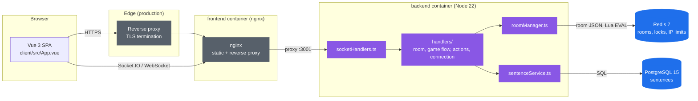
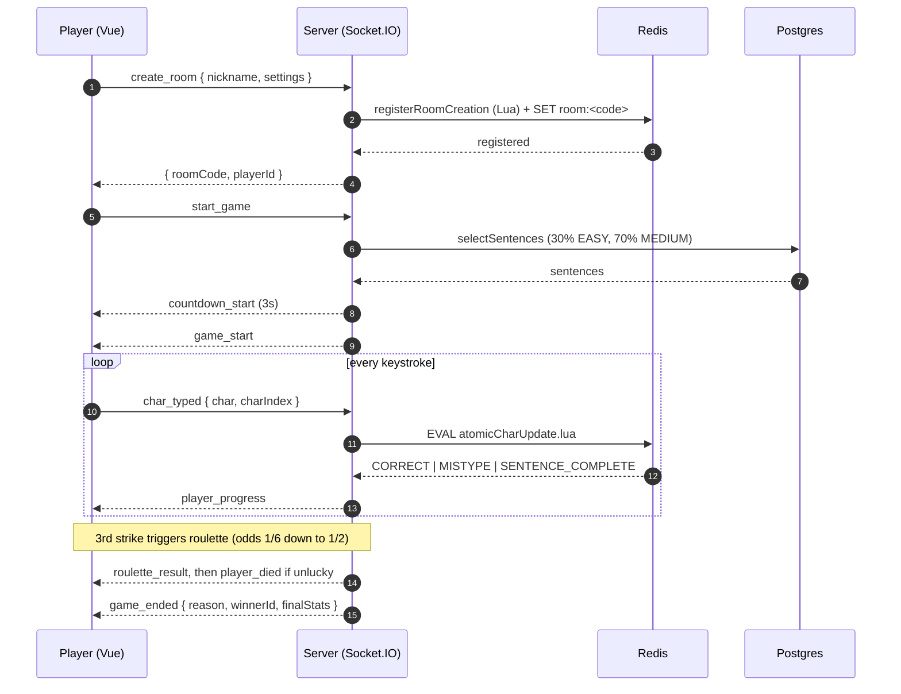

# Type or Die

A real-time multiplayer typing survival game: race to type sentences under a time
limit, and survive a Russian-roulette penalty every three mistakes. Built as a
TypeScript monorepo.

<div align="center">

[]()
[]()
[]()
[]()
[]()
[]()
[]()

</div>

<h2 align="center">
  <a href="https://typeordie.org/">Play at typeordie.org</a>
</h2>

<p align="center">
  Found a bug? <a href="https://github.com/TheJaydenProject/type-or-die/issues/new">Report it</a>.
</p>

<details open>
  <summary>Table of contents</summary>

- [Run it](#run-it)
- [What it is](#what-it-is)
- [How the system works](#how-the-system-works)
  - [Architecture](#architecture)
  - [Primary flow: create a room, start, type, die](#primary-flow-create-a-room-start-type-die)
- [Why it is built this way](#why-it-is-built-this-way)
- [For developers](#for-developers)
- [Testing](#testing)
- [Troubleshooting](#troubleshooting)
- [Known issues](#known-issues)
- [License](#license)

</details>

---

## Run it

This is the shortest path to a running game on your own machine. It assumes you
have never used a terminal. Every command is copy-paste, in order.

### 1. Install Docker Desktop

Download it from https://www.docker.com/products/docker-desktop and run the
installer, then start Docker Desktop and leave it running.

To check it worked, open a terminal (Windows: press the Windows key, type
"PowerShell", press Enter) and run:

```bash
docker --version
```

You should see something like `Docker version 27.x.x`. If you see "command not
found", Docker is not installed or not running.

### 2. Download the project

```bash
git clone https://github.com/TheJaydenProject/type-or-die.git
cd type-or-die
```

If you do not have `git`, install it from https://git-scm.com, or download the ZIP
from the repository page and unzip it.

### 3. Create the sentence database file

The sentence pool is not in the repository, so the game ships without sentences.
Create a file named `init-sentences-db.sql` in the project root and paste in the
schema and at least a handful of sentences (see
[Database seed file](#database-seed-file) below for the exact schema).

**Success looks like:** the file `init-sentences-db.sql` exists in the project
root next to `package.json`.

### 4. Create the settings file

Create a file named `.env` in the project root and paste in the block from
[Environment variables](#environment-variables). These are development-only
values; they are fine for a local run.

### 5. Start the game

```bash
docker compose -f docker-compose.local.yml up -d
```

The first run downloads images and builds the app. It can take a few minutes; a
wall of text is normal.

**Success looks like:** after a minute or two, `docker compose -f
docker-compose.local.yml ps` shows four services with state `running`.

### 6. Play

Open http://localhost:8080 in a browser.

- Type a name, choose a sentence count, and click **CREATE ROOM**.
- To test multiplayer, open http://localhost:8080 in a second browser window,
  enter the same room code, and click **JOIN ROOM**.
- The host clicks **BEGIN PROTOCOL** to start.

**Success looks like:** a 3-2-1 countdown, then a sentence to type. Type it
correctly before the timer runs out.

### Stopping and restarting

Stop the game:

```bash
docker compose -f docker-compose.local.yml down
```

Restart after changing code (rebuilds the images):

```bash
docker compose -f docker-compose.local.yml up --build -d
```

---

## What it is

Players race to type randomly generated sentences within a time window. Every
mistake adds a strike. On the third strike, a roulette spin decides the player's
fate: survival odds start at 1 in 6 and worsen with each survival, so the longer
you last, the more dangerous each spin becomes. Eliminated players become
spectators. The client uses a brutalist terminal aesthetic: monospace type,
uppercase labels, and a high-contrast palette (`client/src/App.css`).

| Feature | Detail |
|---|---|
| Real-time sync | Up to 16 concurrent players per room, live state over Socket.IO |
| Risk mechanic | 3 strikes triggers a roulette roll; odds start at 1/6, floor at 1/2 |
| Difficulty ramp | Sentences served easy-first, then medium |
| Spectators | Eliminated players and late joiners watch the match live |
| Reconnection | A disconnect grace period lets a player resume their session |
| Host controls | Kick, change sentence count, reset, and replay |

---

## How the system works

### Architecture



Edges are grounded in `client/nginx.conf` (proxy of `/socket.io` and `/api` to
`backend:3001`), `server/src/index.ts` (Express + Socket.IO wiring),
`server/src/handlers/*` (dispatch), `roomManager.ts` (Redis), and
`sentenceService.ts` (Postgres).

### Primary flow: create a room, start, type, die



Grounded in `roomLifecycleHandlers.ts`, `gameFlowHandlers.ts`,
`playerActionHandlers.ts`, `lua/atomicCharUpdate.lua`, and the event names in
`shared/src/index.ts`.

---

## Why it is built this way

Each entry states the decision, the alternatives, the reason, and the trade-off.
Rationale that is not recorded anywhere in the repository is labelled **inferred**.

### Redis holds live room state (not Postgres)

- **Decision:** each room is a single JSON blob in Redis (`room:<CODE>`), written
  with a TTL. See `roomManager.ts`.
- **Alternatives:** a Postgres `rooms` table; in-process memory.
- **Why this one:** gameplay is a high-frequency, short-lived write workload (a
  character event per keystroke per player). Redis gives sub-millisecond reads and
  writes, native TTL expiry, and atomic scripts, none of which a per-keystroke
  SQL write path matches. `[inferred: no ADR found in the repo]`
- **Trade-off:** room state is in-memory and short-lived. AOF persistence is now
  enabled (`--appendonly yes`), so a restart replays the append log and in-progress
  rooms survive; a crash between fsyncs can still lose up to the last second.
- **Objection:** "Why not just use Postgres for everything and skip Redis?"
  **Answer:** a row lock and JSON round-trip per keystroke across 16 players cannot
  hold the latency budget; Redis is the state store and Postgres is the durable
  read-only sentence store.

### Character validation runs in a Lua script

- **Decision:** `atomicCharUpdate.lua` validates the typed character, advances
  position, and recomputes WPM inside one Redis `EVAL`. See
  `server/src/lua/atomicCharUpdate.lua`.
- **Alternatives:** read-modify-write in TypeScript; optimistic concurrency with a
  version field.
- **Why this one:** the update is a read-modify-write of the room blob. Under
  concurrent events a plain read-modify-write loses updates. Redis runs a script
  atomically, so the read, the mutation, and the write cannot interleave.
- **Trade-off:** game rules now live in Lua as well as TypeScript. The logic is
  split across two languages and the Lua is harder to type-check and debug. The
  Dockerfile has to copy the `.lua` files into `dist/` by hand
  (`server/Dockerfile`).

### A per-room distributed lock serialises structural changes

- **Decision:** `roomManager.withLock(roomCode, fn)` guards joins, leaves, and
  reconnects using `SET key value NX EX` plus a Lua compare-and-delete release.
- **Alternatives:** rely on the Lua atomic update alone; a global lock.
- **Why this one:** adding or removing a player is a multi-step sequence (read
  room, mutate, write). The per-room lock serialises those without serialising the
  whole server. `[inferred]`
- **Trade-off:** lock contention adds latency under load, and the lock has a TTL
  (`LOCK_TTL = 5s`) with bounded retries (`LOCK_RETRY_ATTEMPTS = 20`), so a stuck
  holder blocks that room for up to five seconds.

### A per-player event queue serialises each player's keystrokes

- **Decision:** a player's gameplay events run one at a time through a promise
  chain keyed by player id. See `queuePlayerEvent` in
  `server/src/utils/playerStateHelpers.ts`.
- **Alternatives:** process each event immediately; rely only on the Lua atomic
  update.
- **Why this one:** events for a single player (char_typed, mistype,
  sentence_timeout) can arrive back-to-back. The Lua script makes each write
  atomic, but ordering across those events still matters for the state the script
  reads; the queue guarantees a player's events apply in order without blocking
  other players. `[inferred]`
- **Trade-off:** one slow handler delays that player's later events, and the queue
  is in-process, so it neither survives a restart nor is shared across server
  instances.

### Sentences live in Postgres

- **Decision:** the sentence pool is a `sentences` table queried by difficulty with
  `ORDER BY RANDOM()`. See `sentenceService.ts` and `init-sentences-db.sql`.
- **Alternatives:** sentences in code; sentences in Redis.
- **Why this one:** the pool is durable, larger than memory-friendly to hand-edit,
  and queried by indexed columns (`difficulty`, `is_active`). Postgres fits a
  read-mostly, low-write dataset.
- **Trade-off:** random selection avoids `ORDER BY RANDOM()` by sampling after a
  random UUID boundary over the primary key, so the cost is roughly
  `O(log n + k)` rather than a full scan and sort. It relies on `id` being a random
  UUID (`gen_random_uuid()`); a non-random id scheme would bias the sample.

### One shared package defines the socket contract

- **Decision:** `@typeordie/shared` holds the event and entity types used by both
  client and server (`shared/src/index.ts`).
- **Alternatives:** duplicate types per package; generate types from a schema.
- **Why this one:** the Socket.IO contract is the riskiest interface in the system.
  A single source of truth means a server event change breaks the client build
  instead of failing silently at runtime.
- **Trade-off:** both packages must build against the shared package, which is why
  the Dockerfiles build `shared` before `server` and `client`.

### Deployed as a single Compose stack behind a reverse proxy

- **Decision:** CI builds, type-checks, and lints, then deploys over an
  authenticated tunnel to one host running Docker Compose; a reverse proxy
  terminates TLS for the domain. The production Compose stack is gitignored.
- **Alternatives:** a managed platform; Kubernetes.
- **Why this one:** one small host and one domain, so a single Compose stack plus a
  reverse proxy is the least infrastructure that meets the need.
- **Trade-off:** the deploy is single-host, so there is no horizontal scale and no
  high availability. `[inferred]`

---

## For developers

### Prerequisites

- Docker and Docker Compose (the recommended path), or
- Node.js 22 and local Postgres 15 and Redis 7 (for running without Docker).
  CI builds on Node 20.

### Run without Docker

Requires Postgres and Redis reachable locally, plus the same `.env`. Then:

```bash
npm install
npm run dev
```

This runs the server and client together via `concurrently`. Client on
`http://localhost:5173`, server on `http://localhost:3001`. Set
`VITE_API_URL=http://localhost:3001` for the client if it is not already set.

### Project structure

```
type-or-die/
  client/          Vue 3 + Vite frontend
    src/
      App.vue                 view state machine (MENU, LOBBY, COUNTDOWN, GAME, FINISHED)
      components/game/        GameController.js (typing logic), HUD, typing field
      composables/            socket event wiring
  server/          Node.js + Express + Socket.IO backend
    src/
      index.ts                server bootstrap, health check, rate limit
      handlers/               socket event handlers by concern
      services/               roomManager (state + locks), sentenceService (Postgres)
      lua/                    atomic Redis scripts
      utils/                  validation, session, player state, Lua loader
  shared/          @typeordie/shared: socket protocol + entity types
  load-tests/      k6-style load test (loadtest.ts)
  docker-compose.local.yml   local development stack
  docker-compose.yml         production stack (gitignored)
  init-sentences-db.sql      DB schema + seed (gitignored; you create it)
```

### Key server files

| File | Purpose |
|---|---|
| `server/src/index.ts` | Bootstrap, CORS, helmet, rate limit, `/health`, graceful shutdown |
| `handlers/roomLifecycleHandlers.ts` | create/join/leave/kick/change settings |
| `handlers/gameFlowHandlers.ts` | countdown, start, reset, replay |
| `handlers/playerActionHandlers.ts` | char_typed, mistype, timeout, game-over |
| `handlers/connectionHandlers.ts` | disconnect grace period, reconnect, heartbeat |
| `services/roomManager.ts` | room state, distributed lock, IP limits, janitor |
| `services/sentenceService.ts` | sentence selection by difficulty, pool stats |
| `lua/atomicCharUpdate.lua` | atomic char validation, advancement, WPM |
| `utils/socketValidation.ts` | `CONSTANTS` (strikes, odds, timers), input validation |

### Game constants

From `server/src/utils/socketValidation.ts`:

| Constant | Value | Meaning |
|---|---|---|
| `MAX_STRIKES` | 3 | Strikes before a roulette roll |
| `INITIAL_ROULETTE_ODDS` | 6 | First roll is 1 in 6 |
| `MIN_ROULETTE_ODDS` | 2 | Best possible odds are 1 in 2 |
| `COUNTDOWN_DURATION` | 3000 ms | Pre-game countdown |
| `ROULETTE_ANIMATION_MS` | 5000 ms | Roulette animation / death delay |
| `GAME_DURATION_TIMEOUT` | 20000 ms | Sentence time window |
| `DISCONNECT_GRACE_PERIOD` | 30000 ms | Reconnect window, from `DISCONNECT_GRACE_PERIOD_MS` |
| `MAX_NICKNAME_LENGTH` | 20 | Nickname cap |

### Configuration

Environment variables (root `.env`; see `.env` in the repo for current values):

| Variable | Purpose |
|---|---|
| `PORT` | Server port (3001 inside Docker) |
| `NODE_ENV` | `development` or `production` |
| `CLIENT_URL` | Allowed CORS origin |
| `DB_HOST`, `DB_PORT`, `DB_NAME`, `DB_USER`, `DB_PASSWORD` | Postgres connection |
| `REDIS_HOST`, `REDIS_PORT`, `REDIS_PASSWORD` | Redis connection |
| `JWT_SECRET`, `SESSION_SECRET` | Session token signing |
| `MAX_ROOMS_PER_IP` | Active rooms allowed per IP |
| `MAX_GLOBAL_ROOMS` | Total active rooms |
| `MAX_ROOM_CREATIONS_PER_HOUR` | Room creation rate limit |
| `DEFAULT_TIME_PER_SENTENCE` | Sentence time window |
| `MAX_WPM_THRESHOLD` | WPM ceiling |
| `DISCONNECT_GRACE_PERIOD_MS` | Reconnect grace window in ms (default 30000) |
| `ROOM_TTL_SECONDS` | Redis room expiry |

### Health check

```bash
curl http://localhost:4900/health
```

Returns `{ status, timestamp, uptime, metrics }`, or `503` with `status:
"degraded"` if Redis or Postgres is unreachable.

### Linting and formatting

The project uses [Biome](https://biomejs.dev/). From the root:

```bash
npx biome check .          # check
npx biome check --write .  # auto-fix
```

### Database seed file

`init-sentences-db.sql` is gitignored and not present after a fresh clone. Create
it in the project root. Docker runs it automatically on first Postgres startup via
the volume mount in `docker-compose.local.yml`. The schema must match:

```sql
CREATE TABLE IF NOT EXISTS sentences (
  id UUID PRIMARY KEY DEFAULT gen_random_uuid(),
  text VARCHAR(500) NOT NULL,
  word_count INTEGER NOT NULL CHECK (word_count BETWEEN 8 AND 12),
  char_count INTEGER NOT NULL,
  language VARCHAR(10) DEFAULT 'en' CHECK (language = 'en'),
  contains_emoji BOOLEAN DEFAULT FALSE CHECK (contains_emoji = FALSE),
  difficulty VARCHAR(20) DEFAULT 'MEDIUM',
  tags TEXT[],
  created_at TIMESTAMP DEFAULT NOW(),
  is_active BOOLEAN DEFAULT TRUE,
  death_rate FLOAT DEFAULT 0.0,
  average_time FLOAT,
  CONSTRAINT unique_sentence UNIQUE(text)
);

CREATE INDEX IF NOT EXISTS idx_word_count ON sentences(word_count);
CREATE INDEX IF NOT EXISTS idx_active ON sentences(is_active) WHERE is_active = TRUE;
CREATE INDEX IF NOT EXISTS idx_difficulty ON sentences(difficulty);
CREATE INDEX IF NOT EXISTS idx_death_rate ON sentences(death_rate);

-- Add sentences here. Each is 8-12 words, no apostrophes, ends with a period.
-- Only . , - punctuation is allowed. Provide enough EASY and MEDIUM rows to
-- cover the largest game (up to 100 sentences).
INSERT INTO sentences (text, word_count, char_count, difficulty, tags, language)
VALUES
  ('The dog ran across the open green field.', 8, 41, 'EASY', '{nature}', 'en'),
  ('She left her bag near the front door.', 8, 37, 'EASY', '{everyday}', 'en');
```

Note: `sentenceService.selectSentences` requests 30% EASY and the remainder
MEDIUM, so a game needs enough rows in both tiers or it throws
`Insufficient ... sentences in pool`.

---

## Testing

Load test: simulates 16 players typing at roughly 140 WPM with random
disconnects. See `testing.md` for details.

```bash
cd load-tests
$env:TARGET_URL="http://localhost:4900"; npx ts-node loadtest.ts
```

Pass criteria: the game ends with `Reason: COMPLETION`, an acked/emitted ratio
above 95%, zero errors, and the backend still running.

---

## Troubleshooting

| Symptom | Likely cause | Fix |
|---|---|---|
| `docker: command not found` | Docker not installed or not running | Install/start Docker Desktop, re-run step 1 |
| Frontend loads but never connects | Backend not up yet | Wait for `docker compose ps` to show all four `running` |
| "Insufficient EASY sentences in pool" | Seed file missing or too few rows | Add more rows to `init-sentences-db.sql`, recreate the DB |
| Room not found after creating | Room TTL expired (idle) | Recreate the room |
| `EADDRINUSE` on 3001 or 5173 (non-Docker) | Port already in use | Stop the other process or change `PORT` |
| Data looks stale after a code change | Images not rebuilt | `docker compose -f docker-compose.local.yml up --build -d` |

---

## Known issues

- **No real accounts.** Players are guests (`isGuest: true`); there is no login, so
  per-user history is not durable.

---

## License

Distributed under the MIT License. See [LICENSE](LICENSE).

## Contact

Jayden Wong ([@TheJaydenProject](https://github.com/TheJaydenProject)) -
https://github.com/TheJaydenProject/type-or-die

## Acknowledgments

Inspired by Final Sentence on Steam.
